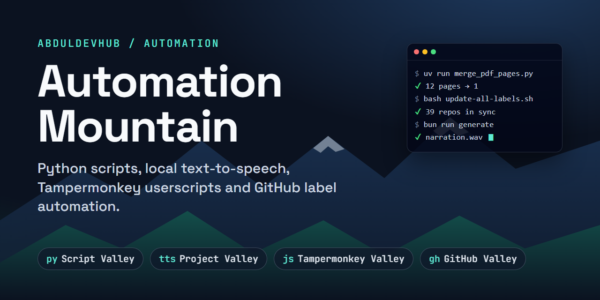

<p align="center">
  
</p>

# Automation Mountain: Python Scripts, Local Text-to-Speech, Userscripts and GitHub Label Automation

[](https://github.com/AbdulDevHub/Archive-Mountain/actions/workflows/sync-labels.yml)


## Project Overview

This repo holds the small tools I wrote to stop doing repetitive things by hand. Each one is a short script that does one job, grouped into "valleys" by type: Python command-line scripts for files and media, a narrator that turns text files into audio on my own machine, browser userscripts that fix annoying site behaviour, and scripts plus a daily GitHub Action that keep my repos' issue labels consistent without me having to remember to run anything.

What's inside: Python CLI scripts (PDF merging, video loop finding, WAV to MP3, a web story downloader), a local Kokoro-82M text-to-speech batch narrator, Tampermonkey userscripts, and GitHub CLI scripts that keep a scoped issue-label scheme in sync across every repo.

| Valley | What's inside | Stack |
| --- | --- | --- |
| [Script Valley](Script%20Valley/) | PDF page merger, seamless video loop finder, WAV → MP3 batch converter, story downloader | Python, uv |
| [Project Valley / Audio Generation](Project%20Valley/Audio%20Generation/) | Batch text-to-speech narration from `.txt` files with Kokoro-82M (local ONNX, plus a Colab GPU notebook) | Bun / Node, kokoro-js |
| [Tampermonkey Valley](Tampermonkey%20Valley/) | Userscripts for scrolling, fullscreen, video stretching, dark mode and YouTube Shorts redirects | JavaScript |
| [GitHub Valley](GitHub%20Valley/) | Scoped GitHub label scheme (`Status:` / `Type:` / `Priority:` / `Resolution:`), auto-synced daily by a GitHub Action | Bash, GitHub CLI |

---

## 🐍 Script Valley: Python Automation Scripts

Each script is a standalone CLI with `--help`. One `uv` project holds all the dependencies.

```bash
cd "Script Valley"
uv sync
uv run merge_pdf_pages.py input.pdf                 # every page → one seamless long page
uv run find_loop.py "assets/Brown Noise.webm"       # find a seamless loop, export it with audio
uv run wav_to_mp3.py "../Project Valley/Audio Generation/audio"
uv run download_stories.py --list stories.txt       # or: --author <works page URL>
```

| Script | What it does |
| --- | --- |
| `merge_pdf_pages.py` | Renders PDF pages, trims blank margins, and stitches them into one continuous page (needs [Poppler](https://poppler.freedesktop.org/)) |
| `find_loop.py` | Finds the frame that best matches an anchor frame (lowest MSE) and cuts a seamless loop with ffmpeg stream copy, audio included |
| `wav_to_mp3.py` | Batch-converts `.wav` to speech-quality MP3 (64k by default, about 6× smaller) |
| `download_stories.py` | Downloads multi-page web stories to `.txt` with a `Title / Description / URL` header that the TTS parser reads |

Full options are in [Script Valley/README.md](Script%20Valley/README.md).

---

## 📖 Project Valley: Local Text-to-Speech Narration (Kokoro-82M)

Turns a folder of plain `.txt` files into narrated `.wav` audio using [Kokoro-82M](https://huggingface.co/onnx-community/Kokoro-82M-ONNX) through `kokoro-js`. It runs fully locally on ONNX, with no API keys.

```bash
cd "Project Valley/Audio Generation"
bun install
bun run generate                                    # ./stories → ./audio
node generate.mjs "C:\path\to\texts" --out "C:\path\to\audio" --voice af_nicole --limit 5
bun run voices                                      # audition every af_* voice
```

- Text is split into sentence-sized chunks, synthesized one at a time, silence-trimmed, and stitched together with natural pauses (sentence, line, paragraph, scene break).
- Files that already have audio are skipped, so re-runs only fill gaps (`--force` to redo them).
- `story_audio_colab.ipynb` is a Python port for Google Colab's free GPU that reads and writes Google Drive and outputs MP3.

Details: [Project Valley/Audio Generation/README.md](Project%20Valley/Audio%20Generation/README.md).

---

## 🛠 Tampermonkey Valley: Userscripts

| Userscript | What it does |
| --- | --- |
| `Disable Bing Scroll.user.js` | Stops Bing results from scrolling into the Copilot chat panel |
| `Fullscreen Toggle.user.js` | `Shift + Alt + F` toggles fullscreen on any site |
| `Hide Scrollbar.user.js` | Hides the scrollbar for distraction-free reading (including `file:///` pages) |
| `Horizontal to Vertical Scroll Remapper.user.js` | Turns horizontal wheel input (e.g. the Logitech MX Master thumb wheel) into vertical scroll |
| `Sketchfab.user.js` | Adds model downloads to Sketchfab (third-party, packaged with JSZip and FileSaver) |
| `Video Aspect Ratio Stretcher.user.js` | Stretches videos to fill a 16:10 display |
| `Webtoon Dark Mode.user.js` | Dark background for Webtoon |
| `YouTube Shorts to Watch Redirect.user.js` | Redirects `/shorts/` to `/watch` and handles SPA navigation |

**Install:** get [Tampermonkey](https://www.tampermonkey.net/), open a `.user.js` file's **Raw** view on GitHub, and click **Install**.

---

## 🏷️ GitHub Valley: Scoped Issue Labels for Every Repo

Personal GitHub accounts can't set default labels, so these scripts apply one consistent scheme (19 labels across `Status:`, `Type:`, `Priority:`, `Resolution:`) with the [GitHub CLI](https://cli.github.com/). Defaults like `bug` are **renamed** to `Type: Bug`, not deleted, so tagged issues keep their labels.

```bash
cd "GitHub Valley"
bash init-labels.sh AbdulDevHub/My-New-Repo         # one repo
bash update-all-labels.sh --only-outdated           # every repo that doesn't match yet
bash update-all-labels.sh --dry-run                 # preview only
bash new-repo.sh My-New-Repo --public --desc "..." --topics "a,b"   # create + label in one step
```

**Hands-free upkeep:** the [Sync Labels](.github/workflows/sync-labels.yml) GitHub Action runs daily and fixes any repo created or pushed in the last 3 days, including repos created on github.com. It needs a one-time `LABELS_TOKEN` secret ([setup](GitHub%20Valley/README.md#automatic-sync-github-action)).

Label reference and the reasoning behind it: [GitHub Label Setup](https://dev-mountain.vercel.app/resources/tools-workflow/github-label-setup).

---

## ⚠️ Disclaimer

Everything here is provided as-is, with no warranty. Sites change, so scrapers and userscripts can break without notice. Respect each site's terms of service and content licenses.
