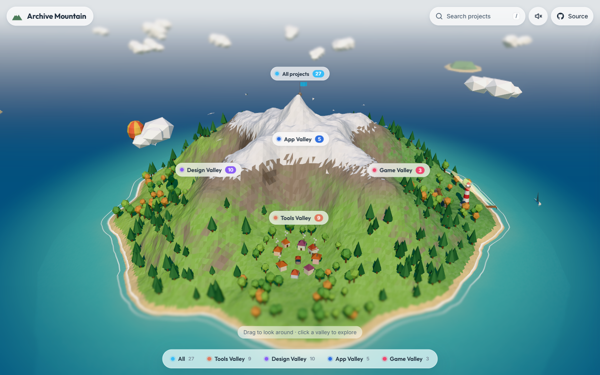

# 🏔️ Archive Mountain: Every Project I've Built, In One Repo

## Project Overview

This repo holds all of my projects in one place: web apps, browser tools, designs and effects, AI tools, mobile apps, automation scripts, backend experiments and university coursework. It used to be seven repos (Web Mountain, University Mountain, Automation Mountain, Mobile Mountain, Case-Cobra, Modern-AliExpress and the original Archive Mountain). They were merged with their full commit history, so every commit keeps its original author and date.

The front page is a **low-poly 3D island** built with TypeScript and Three.js. It shows only the projects worth opening in a browser, across four valleys:

| Valley | What's there |
| --- | --- |
| **Tools Valley** | Browser tools that do one job well: a bulk file renamer, a duplicate finder, an on-device story narrator, a Gitmoji matcher, QR codes and more |
| **Design Valley** | The Effects Playground (26 effects in one site), the Apple homepage, landing pages, portfolios and the Console Wars exhibit |
| **App Valley** | The AI Toolkit (seven AI tools in one site), two full-stack shops, an anime catalogue and a Pokédex |
| **Game Valley** | UNO, War and a Flappy-style arcade game |

The gallery reads its list from [`Gallery/projects.json`](./Gallery/projects.json). See [Gallery/README.md](./Gallery/README.md) for how the island is built.

## What's in the repo

Folders are grouped by kind of project. Everything else that isn't in the gallery (practice projects, server-only code, desktop apps, coursework) still lives here with its history.

| Folder | Contents |
| --- | --- |
| [`Gallery/`](./Gallery) | The 3D island front page and its project list |
| [`Websites/`](./Websites) | Static sites, browser tools and games |
| [`Designs/`](./Designs) | Landing pages, portfolios and UI experiments, including the [Apple Homepage](./Designs/Apple%20Homepage) |
| [`Effects/`](./Effects) | The [Effects Playground](./Effects/Playground) plus one self-contained folder per effect, ready to copy into another site |
| [`Web Apps/`](./Web%20Apps) | Framework apps: [Case-Cobra](./Web%20Apps/Case-Cobra), [Modern-AliExpress](./Web%20Apps/Modern-AliExpress), CareerFlow, Digital Hippo, Anime Vault and more |
| [`AI/`](./AI) | The [AI Toolkit](./AI/AI%20Toolkit) and AI experiments (RAG, LangChain, an MCP server, a Vercel AI chat) |
| [`Desktop Apps/`](./Desktop%20Apps) | Electron apps: an image resizer and a screen recorder |
| [`Chrome Extensions/`](./Chrome%20Extensions) | Gallery Bookmark Viewer, plus links to the extensions that have their own repos |
| [`Backend/`](./Backend) | FastAPI, NestJS, Hono and Redis projects, and Puppeteer scrapers |
| [`Experiments/`](./Experiments) | Tooling and workflow practice: Bun, BullMQ, OpenTelemetry, GitHub Actions, webhooks and more |
| [`Mobile/`](./Mobile) | Android (Kotlin, Jetpack Compose) codelabs and Recurrly, an Expo app |
| [`Automation/`](./Automation) | Python scripts, Tampermonkey userscripts and GitHub label automation |
| [`University/`](./University) | University of Toronto Mississauga coursework: games, data tools, labs and papers |

## Run it locally

- Gallery: `cd Gallery && npm install && npm run dev`. The dev server also serves the rest of the repo, so gallery links work.
- Any single project: open its folder and follow its own README.
- Full deploy build: `bash build.sh`. It builds every gallery project in parallel, then copies only those into `_site/`, which is what Netlify publishes.

## Tech

TypeScript, JavaScript, React, Next.js, Vue, Nuxt, Angular, Svelte, Three.js, GSAP, Tailwind CSS, Node.js, Python, Kotlin, Java and RISC-V assembly, deployed on Netlify (the gallery) and Vercel (the full-stack shops).
