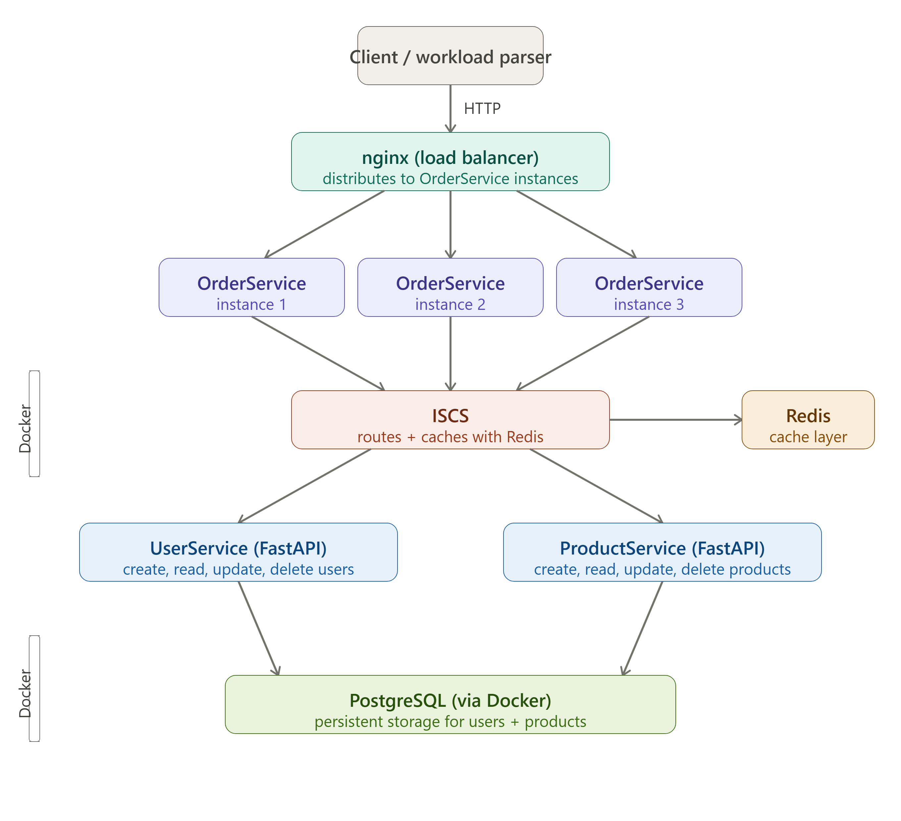
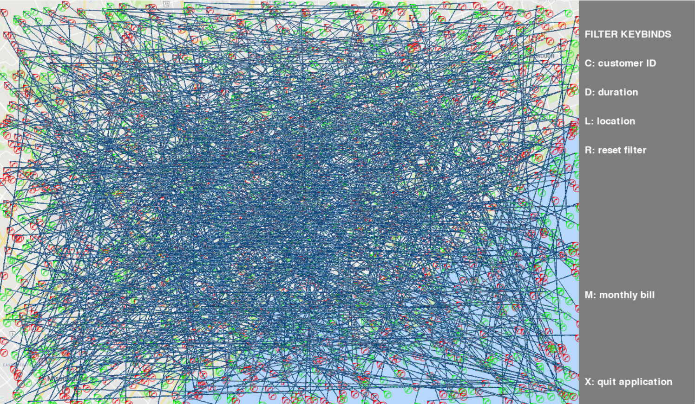

# Exceptional University Projects 🎓💻

This repository is a curated collection of **notable software projects, labs, and assignments** completed during my time at the **University of Toronto Mississauga**. It highlights my work across **Java, Python, SQL, RISC-V Assembly, HTML/CSS/JavaScript, object-oriented design, design patterns, data structures, algorithms, databases, distributed systems, machine learning, theory of computation, and interactive media**.

Rather than serving as a single application, this repo acts as a **portfolio of academic and technical growth**, showcasing both small foundational exercises and larger, system-level projects.

---

## 📂 Repository Overview

The repository is organized into several major projects and collections:

- **Boggle Game** — Full Java implementation of the Boggle word game
- **Computer Science Labs & Assignments** — Python, Java, RISC-V Assembly, SQL, and Turing machine labs covering OOP, design patterns, data structures, computer architecture, databases, machine learning, and theory of computation
- **Shadow In The Dark** — Full-featured survival game written entirely in RISC-V assembly
- **Inventory Server** — Distributed microservice backend with load balancing, caching, and persistence
- **Map Plotting & Search** — Python-based data visualization and filtering system
- **The Twine Interview** — Interactive narrative game exploring bias and decision-making
- **Merged-In Projects** — Pygame arcade shooter, interactive web exhibition, Huffman compression tool, Reddit data analysis, and Tkinter task manager

Each section below links directly to its folder and explains its technical focus.

---

## 🔗 Merged-In Projects

These projects started as their own GitHub repositories and were merged into this one with `git subtree`, keeping every original commit, author, and date. Each folder has its own README.

| Project | What it is | Tech |
| --- | --- | --- |
| **[Space-Invaders](./Space-Invaders)** | Enhanced arcade shooter with spawning enemies, a giant final boss, dynamic music, and power-ups | Python, Pygame |
| **[Console-Wars](./Console-Wars)** | Interactive digital exhibition on the console wars between Nintendo, Sega, Sony, and Microsoft (1989–2005) | HTML, CSS, JavaScript, Anime.js, Plyr.js |
| **[Huffman-Zip](./Huffman-Zip)** | Command-line tool for lossless compression and decompression of any file using Huffman binary trees | Python |
| **[Reddit-Data-Scrapping](./Reddit-Data-Scrapping)** | Research project on public sentiment about Canadian housing, with sentiment analysis and topic modelling of Reddit data | Python, PRAW, Pandas, NLTK, Gensim, pyLDAvis, Jupyter |
| **[Todoist](./Todoist)** | Desktop task manager with create/edit/delete, saving, reminders, and activity-tracking graphs | Python, Tkinter, Matplotlib |

To merge in another project with its full history (leave out `--squash` so the original commits and their contribution-graph dates are kept):

```bash
git subtree add --prefix=Repository-Name https://github.com/AbdulDevHub/Repository-Name main
```

---

## 🎲 Boggle Game (Java)

📁 `Boggle Game/`

A complete **Java-based implementation of the Boggle word game**, including game logic, scoring, persistence, and testing.

### Key Features

- Object-oriented design with clear separation of concerns
- Dictionary-based word validation
- Persistent storage for saved games and scores
- Unit tests to verify correctness
- Modular architecture (game logic, grid, stats, storage)

### Technologies & Concepts

- Java
- OOP principles
- File I/O
- Unit testing
- Data persistence

### Screenshot


---

## 🧪 Computer Science Labs & Assignments

📁 `CS Labs/`

A comprehensive collection of labs across **core computer science courses**, covering programming fundamentals, data structures, algorithms, computer architecture, databases, machine learning, and theory of computation.

---

### 📁 CSC148 - Python

Python labs covering core computer science concepts and data structures.

#### Topics Covered

- Object-Oriented Programming
- Abstract Data Types
- Recursion & Iteration
- Trees, BSTs, Linked Lists
- Sorting algorithms (TimSort)
- Testing & test-driven development

#### Notable Highlights

- **Tree & BST Implementation** (Lab08, Lab09)
- **Recursive List Structures** (Lab06, Lab07)
- **Performance Profiling** (Lab09)
- **TimSort Implementation** (Lab11)

---

### 📁 CSC207 - Java

Java labs emphasizing object-oriented design and software design patterns.

#### Topics Covered

- Object-Oriented Programming (Java)
- Design Patterns:
  - Adapter Pattern
  - Decorator Pattern
  - Observer Pattern
  - Visitor Pattern
- Testing & test-driven development
- Event-driven programming

#### Notable Highlights

- **AST Expression Evaluator** (Lab07) — Visitor pattern implementation
- **Tree Visualization & Filtering** (Lab05) — Event handling and data visualization
- **Braille Translator** (Lab04) — Character encoding and translation
- **Design Pattern Implementations** (Lab06, Lab08, Lab09, Lab10)

---

### 📁 CSC258 - Assembly (RISC-V)

RISC-V assembly projects demonstrating low-level programming, processor behavior, memory systems, pipelining, and performance optimization.

All programs were written and tested using [**CPU-Lator**](https://cpulator.01xz.net/?sys=rv32-spim) and [**Ripes**](https://ripes.me/).

#### Labs Covered

- **Lab 1** — Basic I/O and Arithmetic
- **Lab 2** — Branching and Loops
- **Lab 3** — Arrays and Functions
- **Lab 4** — Recursion and Stack Management
- **Lab 5** — Datapath and Control Signals
- **Lab 6** — Pipelining and Hazards
- **Lab 7** — Cache Performance and Optimization

#### Key Concepts

- RISC-V instruction set architecture
- Function calls and stack frames
- Recursive algorithms in assembly
- 5-stage pipelined processor (IF, ID, EX, MEM, WB)
- Data hazards and forwarding
- Cache locality and memory optimization
- Syscall interface and I/O operations

---

### 📁 CSC311 - Machine Learning

Python labs applying core machine learning algorithms to real-world data (including the NHANES heart-disease dataset), using NumPy, Pandas, Scikit-Learn, and Matplotlib in Jupyter notebooks. Each lab pairs a starter notebook with a fully solved reference notebook.

#### Topics Covered

- NumPy/Pandas fundamentals, vectorization, and data preprocessing
- Supervised learning: k-Nearest Neighbors, Linear & Logistic Regression, Decision Trees, SVMs
- Ensemble methods: Random Forests, Bagging, Boosting
- Unsupervised learning: K-Means clustering, PCA / dimensionality reduction
- Model evaluation (accuracy, precision, recall, train/validation/test splits)

#### Notable Highlights

- **k-NN Classification & EDA** (Lab02) — exploratory data analysis and distance-based classification on the NHANES heart-disease dataset
- **Linear & Logistic Regression** (Lab03, Lab04) — closed-form and gradient-descent regression, plus binary classification with cross-entropy loss
- **Decision Trees & SVMs** (Lab06, Lab07) — information gain/entropy-based splitting and margin-maximizing classifiers with the kernel trick
- **Ensemble Learning** (Lab08) — Random Forests, bagging, and boosting on a train/validation/test pipeline
- **Unsupervised Learning** (Lab10) — K-Means clustering and PCA for dimensionality reduction

---

### 📁 CSC343 - Database

Relational database design and theory using **PostgreSQL**, from writing schemas and queries to normalization and transaction processing.

#### Topics Covered

- Schema definition (DDL) with primary/foreign keys and `CHECK` constraints
- Data manipulation (DML) and SQL queries run through `psql`
- Functional dependencies, attribute closure, and candidate keys
- Normalization: minimal covers, BCNF decomposition, and 3NF
- Transactions: serializability, recoverability, two-phase locking, and isolation levels

#### Notable Highlights

- **Community Library Schema** (Lab 1) — DDL for a library domain (`starter.ddl`) with tables, keys, and integrity constraints
- **Sample Data & DML** (Lab 2) — populating and querying the library schema (`Tutorial2-SQL.dml`)
- **Normalization Report** (Checkpoint 4) — closure and candidate key, minimal cover, BCNF decomposition, and a 3NF dependency-preservation check, written in LaTeX
- **Transactions Report** (Checkpoint 5) — precedence graphs and serializability, aborts and recoverability, two-phase locking, choosing an isolation level, and a read–decide–write hazard
- **Course Archive** (`Documentation/`) — lecture slides and handouts, tutorials, practice midterm questions, and past final exams (Fall 2019, Winter 2019, Winter 2023)

---

### 📁 CSC363 - Turing Machines

Theory of computation labs implementing single-tape and multi-tape **Turing machines** as explicit state-transition tables written in [**Varphi**](https://docs.varphi-lang.com/) (`.vp` format), covering deterministic computation, tape symbol manipulation, and multi-tape coordination.

#### Topics Covered

- Turing machine design via state-transition tables
- Single-tape and multi-tape (dual read/write head) machines
- Binary arithmetic (carry propagation) on a tape
- String comparison across tapes
- Tracing and reverse-engineering machine behavior from transition tables alone

#### Notable Highlights

- **Binary Incrementer** (`binaryIncrementar.vp`) — scans to the end of a binary string, then propagates a carry leftward to increment the value by one, including the overflow case (e.g. `11 + 1 = 100`)
- **Two-Tape Palindrome Checker** (`mystery2.vp`) — copies the input from tape 1 onto tape 2, rewinds tape 1 to the start, then simultaneously scans tape 1 forward and tape 2 backward to verify the input is a palindrome
- **Mystery Machines** (`mystery.vp`, `a1q1.vp`) — larger, undocumented single-tape machines (up to 17 states) used to practice tracing and deducing computed behavior directly from the transition table
- **Hello World Machine** (`hello.vp`) — minimal one-state halting machine used as a baseline sanity check

---

## 🎮 Shadow In The Dark (RISC-V Assembly Game)

📁 `Shadow In The Dark/` — [Full README](./Shadow%20In%20The%20Dark/README.md)


A **full-featured survival horror game** written entirely in RISC-V assembly (~1000 lines). Players navigate a dark maze, collect a match, and light a candle before their fear gauge reaches 100 — all while a shadow monster hunts them down using Manhattan-distance pathfinding.

**Highlights:**

- Procedural map generation via a custom Park-Miller LCG
- Manhattan-distance AI pathfinding with Chebyshev proximity detection
- Unlimited undo stack (512-state buffer) and dynamic heap allocation for multiplayer
- Competitive multiplayer mode with bubble-sort leaderboard and tie detection
- 1000+ lines of modular assembly across 13 subroutines

**Files:**

- **Shadow In The Dark.s** — Complete game implementation
- **Shadow In The Dark – User Guide.pdf** — Gameplay documentation

See the [project README](./Shadow%20In%20The%20Dark/README.md) for full technical architecture, memory management details, and gameplay instructions.

---

## 🧾 Inventory Server (Distributed Systems Project)

📁 `Inventory-Server/`

A large-scale **inventory management backend** built as a distributed microservices system, rebuilt from scratch with a focus on correctness, scalability, and persistence.

### Architecture

- **OrderService** — public-facing entry point, orchestrates orders
- **UserService** — manages users with full CRUD
- **ProductService** — manages products with full CRUD
- **ISCS** (Inter-Service Communication Service) — internal router with Redis caching
- **nginx** — load balancer distributing traffic across OrderService workers
- **PostgreSQL** — persistent storage surviving restarts
- **Redis** — in-memory cache layer reducing database load

### Features

- Fully async REST APIs (FastAPI + asyncpg)
- Redis caching with automatic cache invalidation on writes
- nginx load balancing across multiple OrderService workers
- Race condition protection via PostgreSQL row-level locking (`SELECT FOR UPDATE`)
- Data persistence across restarts via PostgreSQL Docker volume
- System-wide wipe endpoint for clean test runs
- Workload parser with sequential and concurrent modes
- Multi-machine LAN deployment support via config-driven IPs/ports
- Config supports multiple instances per service for horizontal scaling

### Technologies & Concepts

- Python (FastAPI, asyncpg, aiohttp, redis)
- PostgreSQL, Redis
- Docker + Docker Compose
- nginx reverse proxy / load balancing
- Async I/O and connection pooling
- Microservice architecture
- Distributed systems (race conditions, caching, persistence, fault tolerance)

### Architecture Diagram



---

## 🗺️ Map Plotting & Search (Python)

📁 `Map-Plotting-Search/`

A Python application that models **phone calls, billing, and customer data**, with visualization and filtering functionality.

### Features

- Data-driven application design
- Call history tracking
- Map-based visualization
- Modular domain models
- Automated tests

### Technologies

- Python
- Object-oriented design
- Data visualization
- JSON datasets

### Screenshot



---

## 🎭 The Twine Interview (Interactive Narrative)

📁 `The-Twine-Interview/`

An **interactive narrative game** built with Twine and HTML that explores **bias, decision-making, and systemic inequality** through branching dialogue and outcomes.

### Highlights

- Multiple characters and story paths
- Dynamic outcomes based on player choices
- Integrated images and audio
- Social commentary through game design

### Technologies

- Twine
- HTML
- Audio & visual storytelling

### Screenshots


---

## 🛠️ Skills Demonstrated Across This Repository

- **Languages:** Java, Python, SQL, RISC-V Assembly, HTML, CSS, JavaScript
- **Frameworks & Libraries:** FastAPI, Pygame, Tkinter, Twine, Anime.js
- **Databases & Caching:** PostgreSQL, Redis
- **Paradigms:** Object-Oriented Design, Procedural Programming, Low-Level Programming
- **Design Patterns:** Observer, Decorator, Adapter, Visitor
- **Data Structures & Algorithms:** Trees, BSTs, Linked Lists, Stacks, Sorting, Recursion, Pathfinding, Huffman Coding
- **Data Science & NLP:** Pandas, NumPy, Scikit-Learn, Matplotlib, Jupyter, PRAW, NLTK, Gensim (topic modelling)
- **Machine Learning:** k-NN, Regression, Decision Trees, SVMs, Ensemble Methods, Clustering, PCA
- **Database Theory:** ER Modeling, Normalization (BCNF, 3NF), Serializability, Two-Phase Locking
- **Computer Architecture:** Datapath & Control, Pipelining, Cache Performance, Memory Management
- **Theory of Computation:** Turing Machines (single- and multi-tape), State-Transition Design
- **Software Engineering:** Testing, Debugging, Documentation, Version Control (Git, Git Subtrees)
- **System Design:** Microservices, Distributed Systems, Load Balancing, Caching, Docker
- **Interactive Media:** Game Design, Narrative Design, Digital Exhibitions

---

## 📚 Reference Materials

📁 `CS Documentaion/`

Contains reference materials used throughout coursework:

- **JAVA OOP 101.txt** — Java object-oriented programming reference
- **Assembly References/**
  - **Textbook.pdf** — *Computer Organization and Design: RISC-V Edition (Second Edition)*
  - **opcodes.pdf** — RISC-V instruction set reference and opcode formats

---

## 📌 Notes

- Most project folders include their **own README** with implementation-specific details.
- Former standalone repositories are merged in with `git subtree`, so their full commit history lives here.
- This repository is intended for **academic, learning, and portfolio** purposes.
- Code reflects iterative learning and increasing complexity over time.

---

## 📫 Contact

If you'd like to discuss any of these projects, feel free to reach out via GitHub or LinkedIn.
